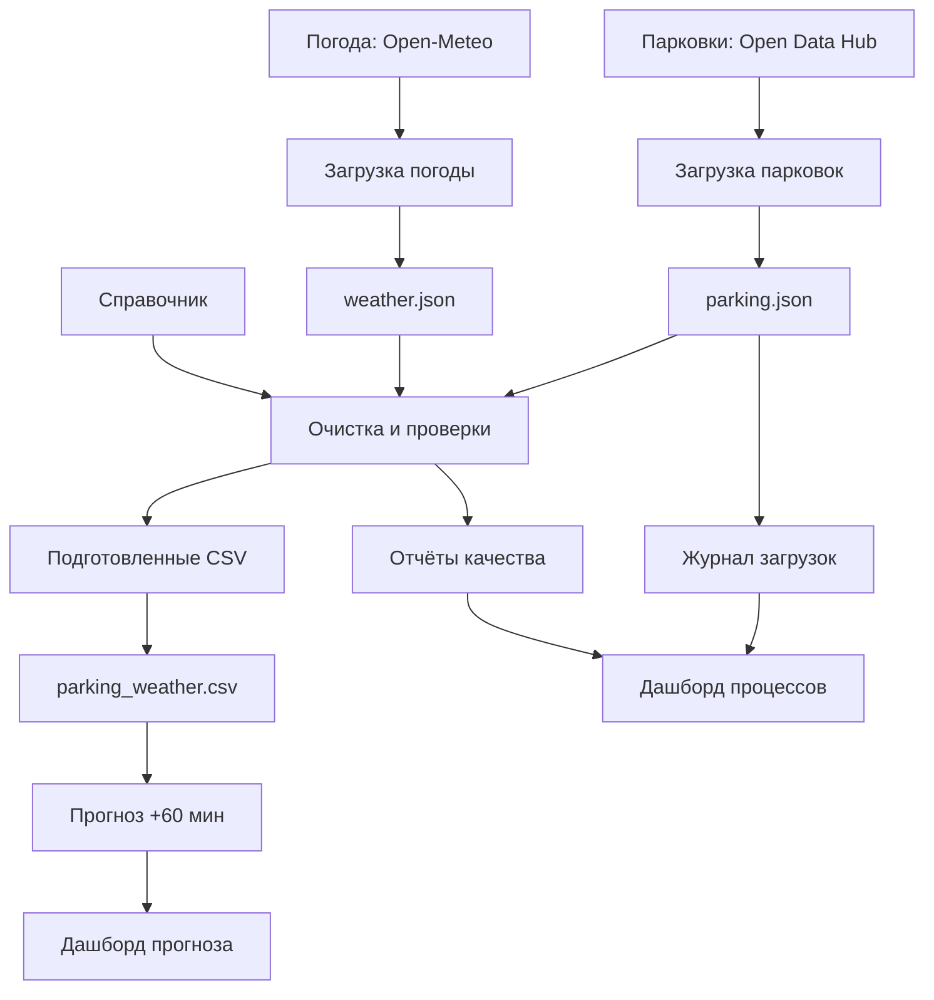

# Архитектура системы и происхождение данных

## Схема системы

Календарные признаки рассчитываются при построении витрины из временных отметок в часовом поясе Europe/Rome. Погодные данные присутствуют в витрине и предметном дашборде, но не используются как признаки модели прогноза.

## Слои хранения

| Слой | Каталог | Назначение |
|---|---|---|
| Исходные выгрузки | `data/raw/` | Сохранённые ответы источников для проверки происхождения данных |
| Накопленные данные | `data/storage/` | Записи без повторов и границы уже загруженного периода |
| Подготовленные данные | `data/processed/` | Проверенные значения, единый формат времени, рассчитанная загрузка и признаки качества |
| Аналитическая витрина | `data/marts/` | Парковочные наблюдения, сопоставленная погода и календарные признаки |
| Данные для моделей | `data/modeling/` | Цели прогноза, хронологические выборки и признаки |

Справочник выбранных парковок и их вместимости находится в `data/reference/parkings.csv`. Правила обработки заданы в `config/processing.json`, структура таблиц — в `config/schemas.json`, а настройки прогноза — в `config/forecasting.json`, `config/features.json` и `config/models.json`.

## Происхождение показателя

Показатель «процент загрузки парковки» можно проследить в обратном направлении:

1. Предметный дашборд читает `occupancy_pct` из `data/marts/parking_weather.csv`.
2. Витрина получает этот показатель из `data/processed/parking_clean.csv`.
3. При подготовке парковочных данных количество занятых мест `occupied` сопоставляется со вместимостью `capacity` из справочника. Процент рассчитывается как `occupied / capacity * 100`.
4. `occupied` происходит из поля `mvalue` записи Open Data Hub, сохранённой в `data/storage/parking.json`. Код парковки и время измерения позволяют найти исходное наблюдение.

Прогноз для определённого времени можно проследить через `reports/models/test_predictions.csv`: там указаны парковка, момент формирования прогноза, целевое время, фактическая загрузка и результаты моделей. Настройки и контрольные суммы файлов зафиксированы в `models/forecast_manifest.json`.

## Контроль выполнения и ограничения

Журнал `logs/load_log.csv` хранит сведения о запусках загрузчиков. Результат последовательной обработки сохраняется в `logs/processing_run.json`, отчёты проверок — в `logs/quality/`. Их показывает операционный дашборд.

Временной ряд наблюдений сохраняет историю загрузки парковок за исследуемый период. При этом справочник содержит вместимость на дату получения справочных данных: история **изменений вместимости** отдельно не подтверждена. Поэтому подготовленные записи содержат соответствующий признак ограничения; текущую справочную вместимость нельзя считать доказанной для каждой прошедшей даты.